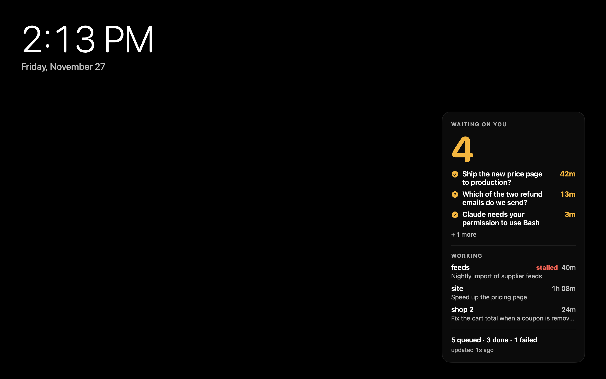

# Jig Screen

A menu bar app for macOS. When you walk away, it covers every display with a clock and a
status panel for your [Jig](https://github.com/HammaRidgeVentures/jig) agents. You can read
from across the room what waits on you.



It is not a real screen saver. An app can't draw over the real one, and the old screen saver
plug-ins are too buggy on new versions of macOS. So Jig Screen watches the idle time itself, and
opens its own full-screen windows.

## Install

You need macOS 13 or newer and the Command Line Tools (`xcode-select --install`). You don't need Xcode.

```bash
make install
```

That builds `Jig Screen.app`, copies it to `/Applications` and opens it. Look for the small
screen icon in the menu bar. Pick **Preview now** to see the screen with the sample data.

The app is signed for this Mac only. To run it on another Mac, build it there.

## Set up macOS (do this once)

Open **System Settings**, then **Lock Screen**.

1. Set **Start Screen Saver when inactive** to **Never**. Jig Screen takes its place.
2. Keep **Turn display off when inactive**. Set it longer than Jig Screen's own time.
3. Keep **Require password after screen saver begins or display is turned off**.

**Jig Screen does not lock your Mac.** Any key, click or mouse move closes it. The display
sleep and the password are your lock, so keep both.

## The menu

| Item | What it does |
| --- | --- |
| **Preview now** | Shows the screen at once. |
| **Start after** | How long the Mac is idle before the screen shows. 5 minutes at first. |
| **Data source** | Where the status comes from. See below. |
| **Background** | A solid color, or a slideshow of your photos. |
| **Launch at login** | Starts Jig Screen when you log in. |

The screen does not show while a video, a call or a presentation keeps the display awake.
It does not show over the lock screen.

## The screen

- **Clock**, top left.
- **Waiting on you.** A large count, and the three questions or approvals that have waited
  longest. This part is amber. With a photo background, the photos turn gray while anything
  waits, so amber is the one color on the screen.
- **Working.** One row for each agent: its name, its task, and how long. A red **stalled** shows
  when the agent's last heartbeat is more than 10 minutes old.
- **Footer.** Queued, done since you went idle, failed. Then the age of the data.
- The panel dims when the data is more than 2 minutes old.
- The clock and the panel move a few points every 3 minutes. That guards against burn-in.

## Data source

| Source | Use it when |
| --- | --- |
| **Sample data** | You want to see the screen with no agents running. |
| **Jig on this Mac** | Your agents run on this Mac. The app runs `jig status --json` once a minute. |
| **A file…** | Something else writes a `status.json` on this Mac. Read every 15 seconds. |
| **A web address…** | Your agents run on another Mac. Read every 15 seconds. |

**Jig on this Mac** needs Jig 0.14.0 or newer. It shows the repos on your queue band
(`band_repos` in `~/.claude/jig.json`).

### Agents on another Mac (for example a Mac mini, over Tailscale)

On the Mac that runs the agents, keep a status file fresh in a folder of its own:

```bash
~/.claude/jig/bin/jig status --json --every 30 --write ~/jig-status/status.json
```

Serve that folder to your tailnet only:

```bash
python3 -m http.server 8787 --bind "$(tailscale ip -4)" --directory ~/jig-status
```

On the Mac with the screen, pick **Data source**, then **A web address…**, and enter
`http://<the-mac's-tailnet-name>:8787/status.json`.

Serve a folder that holds the status file and nothing else. Never serve `~/.claude`: it holds keys.

Plain `http` works for a local name, an IP address and a `ts.net` name. Any other address needs `https`.

### The status file

Anything can write this file. Jig writes it with `jig status --json`. The sample is
[`mock/status.json`](mock/status.json).

```json
{
  "updatedAt": "2026-11-27T19:00:00Z",
  "items": [
    { "id": "acme/shop#208", "title": "Fix the cart total", "kind": "task", "state": "working",
      "agent": "shop", "startedAt": "2026-11-27T18:36:00Z", "waitingSince": null, "completedAt": null }
  ],
  "agents": [
    { "name": "shop", "currentItemId": "acme/shop#208", "lastHeartbeat": "2026-11-27T18:59:48Z" }
  ]
}
```

- `kind`: `question`, `approval` or `task`.
- `state`: `queued`, `working`, `waiting_user`, `done` or `failed`.
- Every time is ISO 8601. A time that is not known is `null`, or left out.
- An agent whose name is on a `waiting_user` item shows under **Waiting on you**, not under **Working**.

## Backgrounds

- **Solid color.** Four dark colors.
- **Photo slideshow.** Choose a folder. The app shows its photos in a random order, each with a
  slow pan and zoom (the Ken Burns effect) and a cross-fade. It reads the folders inside it too.

Over a photo, the clock and the panel sit on a dark, see-through card. White text on it passes
WCAG AA contrast (4.5 to 1) on a pure white photo.

To add a background, write a type that conforms to `SaverBackground` in
`Sources/JigScreen/Backgrounds/`, and list it in `Backgrounds.all`.

## Work on it

| Command | What it does |
| --- | --- |
| `make check` | Runs the checks for the status file and the panel's numbers. |
| `make snapshot` | Draws the screen into `docs/screen.png`, with no display needed. |
| `make app` | Builds `build/Jig Screen.app`. |

The code is SwiftUI in an `NSHostingView`. It has no web view and no outside packages.

- `Sources/JigScreenCore` — the status file's shape, and what the panel shows from it. No UI.
- `Sources/JigScreen` — the app: the idle watch, the windows, the views, the menu.
- `Sources/jig-screen-check` — the checks, as a plain program.

A snapshot takes more options:

```bash
"$(swift build --show-bin-path)/JigScreen" --snapshot out.png --size 1440x900 --source status.json --photos ~/Pictures --clear
```

## Limits

- A permission prompt stays under **Waiting on you** until that session's next tool call.
- Jig has no failed state yet, so **failed** is 0 with Jig's own data.
- The app is not notarized. A Mac that did not build it will refuse to open it.
